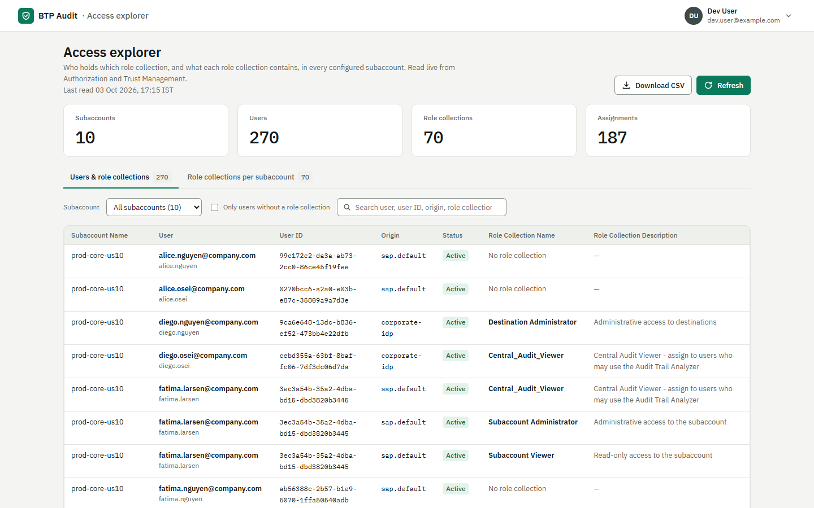
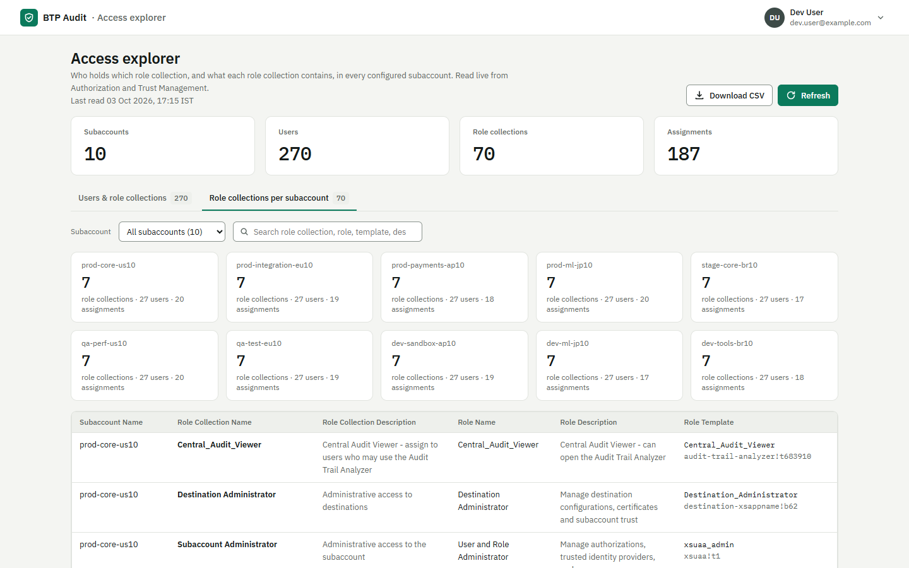

# BTP Audit Analyzer

**Who changed what in your SAP BTP landscape, and who can do it right now?**

BTP Audit Analyzer is a set of three Node.js apps on SAP BTP, Cloud Foundry
environment, behind one login and one launchpad. It reads the audit logs and
the authorization data of several subaccounts and turns them into answers an
auditor can read: plain-language logs, access changes, segregation-of-duties
(SoD) risks, current role assignments and an EarlyWatch-style report.

> This repository is a **showcase only** — features and screenshots. The source
> code is in a private repository. **Want access?** Comment on the LinkedIn post
> or send me a message with your GitHub username, and I will add you with
> read access.

All screenshots use **synthetic sample data** (fictitious users and
subaccounts).

---

## The three apps

| App | For | Role collection |
|---|---|---|
| **Audit Trail Analyzer** | Audit logs, access changes, SoD analysis, analysis report | `Central_Audit_Viewer` |
| **Access Explorer** | Who holds which role collection, and what each contains, per subaccount | `Central_Audit_Viewer` |
| **SoD risk admin** | Maintain the SoD risks the analyzer checks | `SOD_Administrator` (edit) / `SOD_Viewer` (read-only) |

A launchpad shows each user only the apps their role collections allow.

---

## Features

**Human-readable audit logs.** Raw Audit Log Retrieval records become
sentences — *"ann deployed "Order_Sync" 1.0.0"*, *"ann updated integration
package "Test""*, *"ann downloaded data store entry "HT-1037" of data store
"Products""* — with every changed field shown as old → new and secrets hidden.
Built against SAP's documented audit events of **Cloud Integration / Integration
Suite**, **API Management**, **Event Mesh**, **Build Work Zone**, **Build Process
Automation**, **Cloud Transport Management**, the **Destination service**,
**XSUAA** and more; start / completion pairs are merged into one entry.

**Access changes across subaccounts.** User creations, role collection grants
and revokes, role collection and subaccount configuration changes, with
anomaly detection (off-hours and rapid bulk revokes) and self-assignment of
administrator access.

**Segregation of Duties analysis.** A live check, across every configured
subaccount, of who holds each SoD risk — user administration, destination
maintenance, trust configuration maintenance, application maintenance — with
the role collection and role that grant it. Matching is by *role*, so
customer-named role collections are caught too.

**Access Explorer.** For every configured subaccount: a one-to-one *user →
role collection* table (user, user ID, origin, status, role collection and its
description) — including users who exist but hold **no role collection** — and
a *role collection → role* table (role collection, description, role, role
description, role template). The same email under two identity providers is
shown as the two accounts it is.

**SoD risk admin.** Maintain the SoD risks (CSV upload and download, SAP
defaults built in), with an editor role and a read-only viewer role.

**Service instance insights.** Every service instance with who created it, its
service keys (name, creator, date) and its app bindings — from Service Manager
and the Cloud Foundry API.

**Analysis report.** An EarlyWatch-style assessment with key figures, trends,
alert overview, security concerns and findings — exportable to PDF and CSV.

**Secure by design.** Single sign-on through XSUAA, role collections per app,
a launchpad that only shows the apps a user may open, read-only access to every
SAP API, and no credentials in the app: every outbound call goes through the
BTP Destination service.

---

## Screenshots

**Launchpad** — one tile per app the user's role collections allow.

**Dashboard** — choose subaccounts and a period, click Run.

**User changes**

**Application logs** — audit records as plain sentences.

**SoD analysis**

**Access Explorer** — users and their role collections:

… and role collections with their roles, per subaccount:

**Analysis report**

**Service instances** — with creator, service keys and app bindings.

**SoD risk admin**

---

## Built with

SAP BTP Cloud Foundry runtime · SAP Application Router · SAP Authorization and
Trust Management (XSUAA, SCIM and authorization APIs) · SAP Destination
service · SAP Audit Log Retrieval API · SAP Service Manager · SAP Cloud
Management service · Cloud Foundry v3 API · Node.js / Express

## Access

The source code is private. To request read access, contact me with your
GitHub username (LinkedIn comment or message).

© Abhishek Kumar Sinha. All rights reserved.
