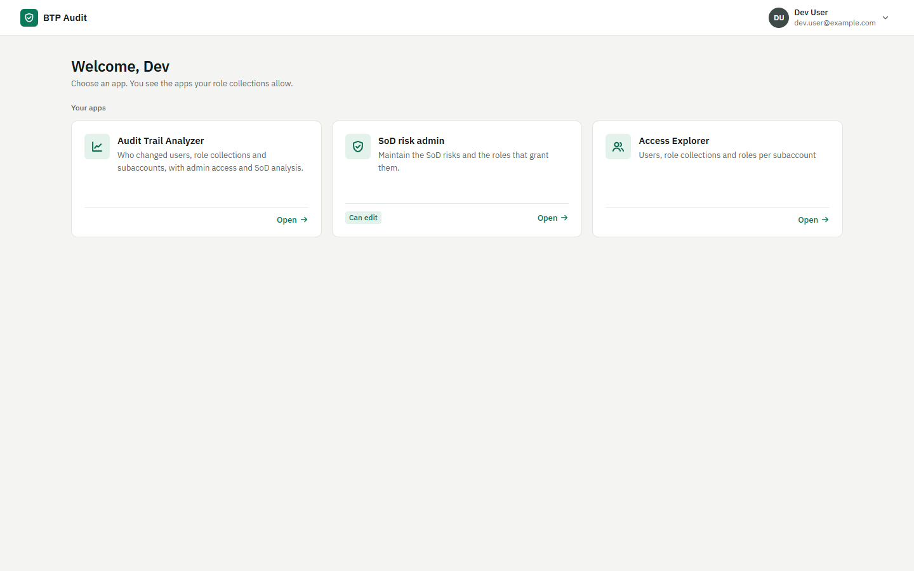
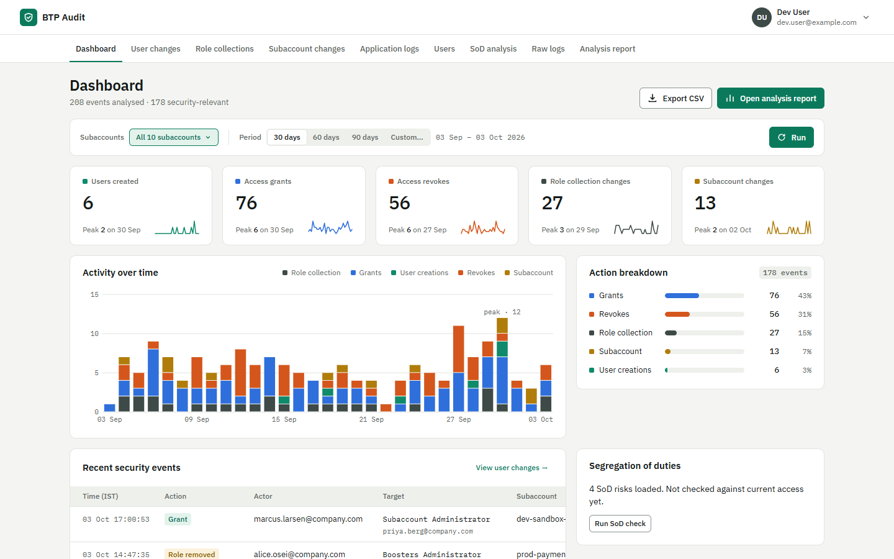
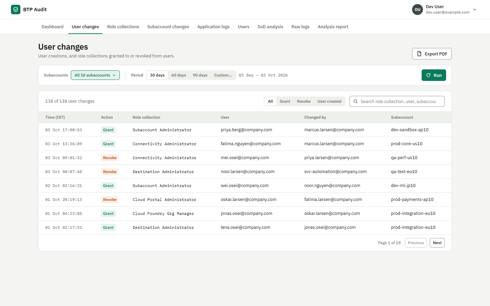
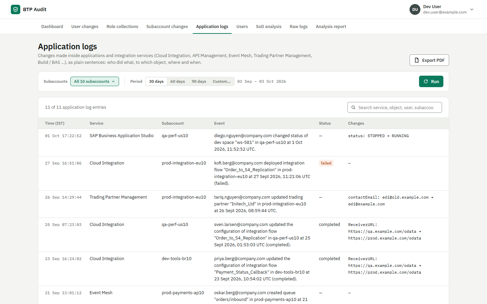
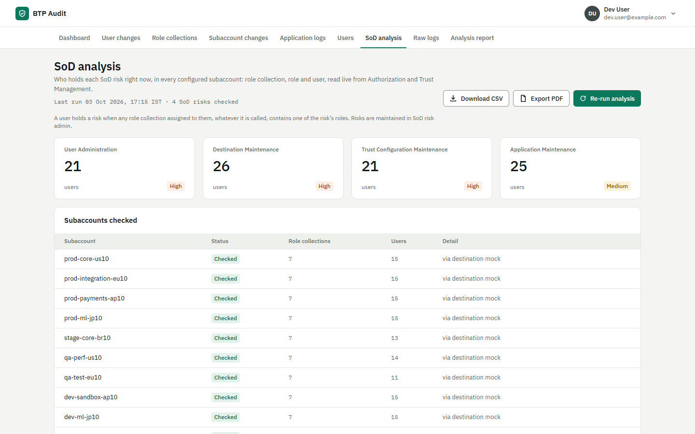
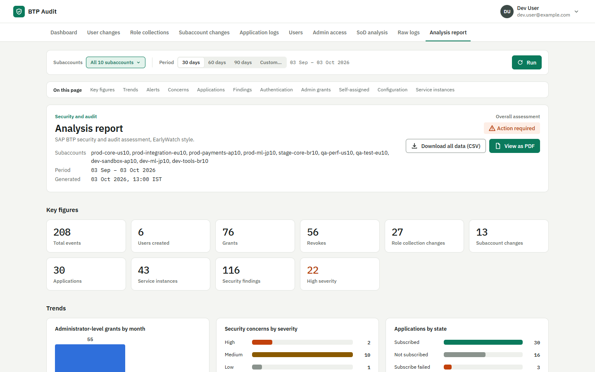
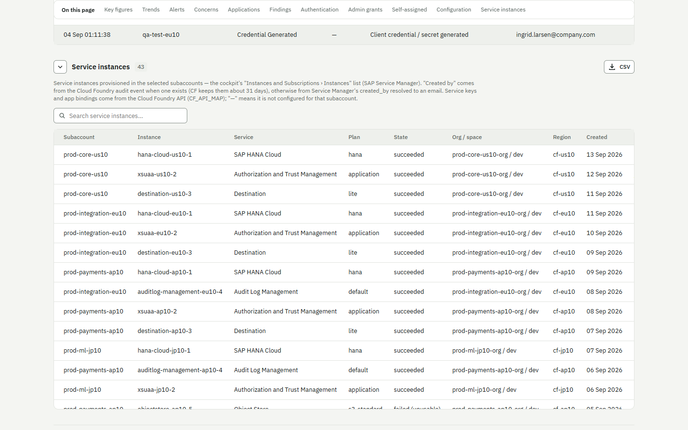
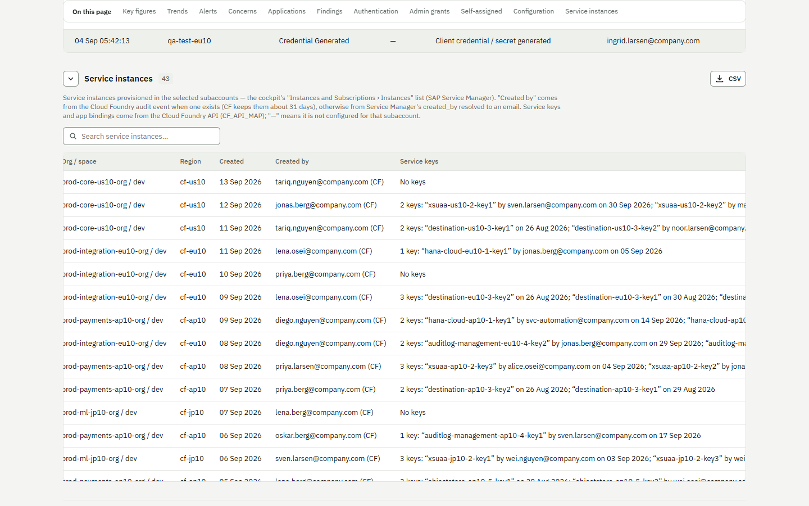
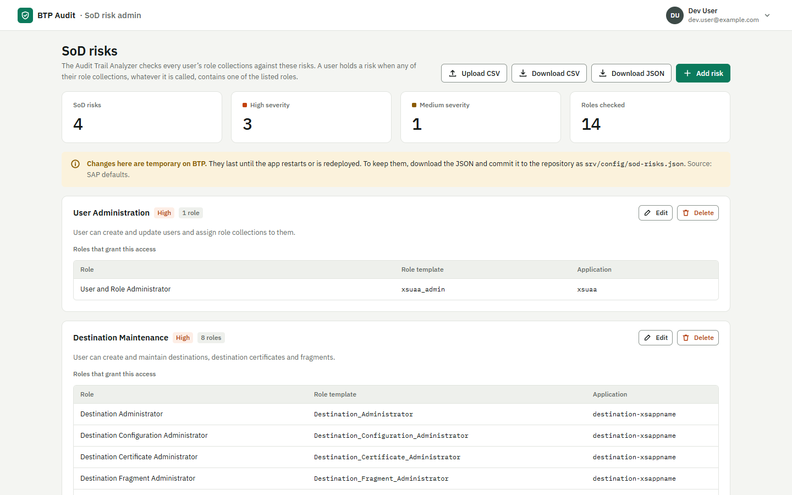

# BTP Audit Analyzer

**Who changed what in your SAP BTP landscape, and who can do it right now?**

BTP Audit Trail Analyzer is a Node.js application running on SAP BTP, Cloud
Foundry environment. It reads the audit logs and authorization data of several
subaccounts and turns them into answers an auditor can read: plain-language
logs, access changes, segregation-of-duties (SoD) risks and an EarlyWatch-style
report.

> This repository is a **showcase only** — features and screenshots. The source
> code is in a private repository. **Want access?** Comment on the LinkedIn post
> or send me a message with your GitHub username, and I will add you with
> read access.

All screenshots use **synthetic sample data** (fictitious users and
subaccounts).

---

## Features

**Human-readable audit logs.** Raw Audit Log Retrieval records become
sentences — *"jane deployed integration flow "Order_Sync" in Prod at 1 Oct 2026,
09:00 UTC (completed)."* — with every changed field shown as old → new and
secrets hidden. Covers Cloud Integration, API Management, Event Mesh, Trading
Partner Management, Build / Business Application Studio and more.

**Access changes across subaccounts.** User creations, role collection grants
and revokes, role collection and subaccount configuration changes, with
anomaly detection (off-hours and rapid bulk revokes) and self-assignment of
administrator access.

**Segregation of Duties analysis.** A live check, across every configured
subaccount, of who holds each SoD risk — user administration, destination
maintenance, trust configuration maintenance, application maintenance — with
the role collection and role that grant it. Matching is by *role*, so
customer-named role collections are caught too.

**SoD risk admin.** A second app to maintain the SoD risks (CSV upload and
download, SAP defaults built in), with an editor role and a read-only viewer
role.

**Service instance insights.** Every service instance with who created it,
its service keys (name, creator, date) and its app bindings — from Service
Manager and the Cloud Foundry API.

**Analysis report.** An EarlyWatch-style assessment with key figures, trends,
alert overview, security concerns and findings — exportable to PDF and CSV.

**Secure by design.** Single sign-on through XSUAA, role collections per app,
a launchpad that only shows the apps a user may open, and no credentials in the
app: every outbound call goes through the BTP Destination service.

---

## Screenshots

**Launchpad** — one tile per app the user's role collections allow.

**Dashboard** — choose subaccounts and a period, click Run.

**User changes**

**Application logs** — audit records as plain sentences.

**SoD analysis**

**Analysis report**

**Service instances** — with creator, service keys and app bindings.

**SoD risk admin**

---

## Built with

SAP BTP Cloud Foundry runtime · SAP Application Router · SAP Authorization and
Trust Management (XSUAA) · SAP Destination service · SAP Audit Log Retrieval
API · Authorization and Trust Management API · SAP Service Manager · Cloud
Foundry v3 API · Node.js / Express

## Access

The source code is private. To request read access, contact me with your
GitHub username (LinkedIn comment or message).

© Abhishek Kumar Sinha. All rights reserved.
